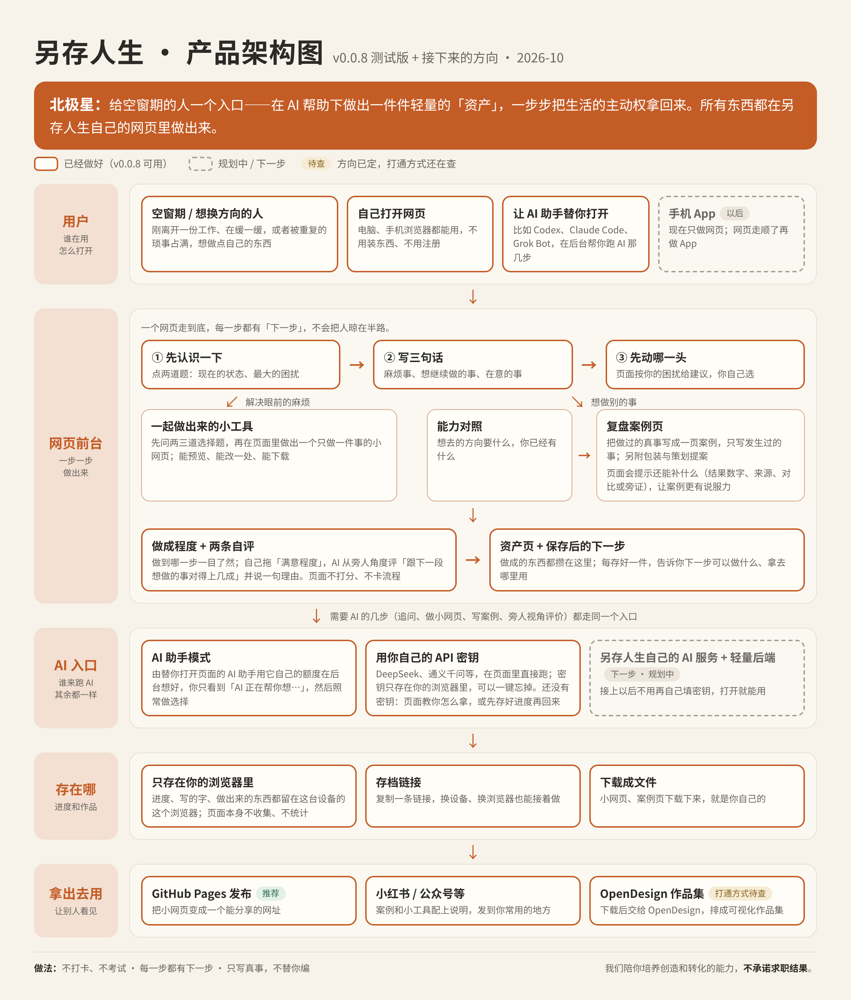

# 另存人生 · 产品需求文档（PRD）

> 版本：v0.0.8 测试版 + 接下来的方向  
> 日期：2026-10-23  
> 状态：测试期文档，给第一次了解这个项目的人看。凡是标「待拍板」「待查」「规划中」的，都还没定。

---

## 1 背景与问题

**一句话**：另存人生是一个网页。它陪想改变现状、还没真正用 AI 做成过东西的人，在 AI 帮助下先做出一件小而真实的东西，再一件件攒成自己的「轻量资产」。

很多人正处在空窗期：刚离开一份工作、在缓一缓，或者每天被重复的琐事占满，想做点自己的东西。他们会和 AI 聊天，但遇到的问题往往不是「不会用 AI」，而是：

- **不知道 AI 能为自己做什么、该先做哪一件。**
- **聊完只拿到一段文字或代码，没有一件真能用、能给人看的东西。**
- **做过不少事，却说不清自己会什么**；想换方向时，不知道过去的经历哪些算数。
- **每一步做完就停在原地**，不知道下一步做什么，于是半途而废。

前几轮测试里，我们试过「把说明复制给用户自己的 AI 去做」。结果是：中间那段「真正做出来」的路，用户自己走不下来；要在好几个工具之间来回切，时间和精力成本都太高。所以从 v0.0.8 起，**整个过程都放进另存人生自己的网页里**。

## 2 目标用户与场景

### 2.1 给谁用

| 是 | 不是 |
|---|---|
| 空窗期的人：刚离开一份工作，在缓一缓 | 从没用过 AI、也不想改变现状的人 |
| 还在上班，但想做点不一样的 | 已经会部署、会改开源项目的人 |
| 在读书或刚毕业，想开始做点东西 | 想找人、找社群、找培训课的人 |
| 心里一直有件想做、没空做的事 | |

不预设用户手里有作品。很多人现在什么都没有，就是想开始。

「零基础」的标准不是「用没用过 AI」，而是「能不能靠 AI 自己做出一个下周还会打开的东西」。

### 2.2 典型场景

1. **被琐事占满**：每周手抄同一张投递记录表，还老漏。→ 在页面里做出一个只做这一件事的小网页，当天就能用。
2. **想换方向，说不清自己会什么**：做过几年展会和活动，想转去做内容营销。→ 看看想去的方向要什么、自己已经有什么，再把一段真实经历写成一页复盘案例，当作第一份证据。
3. **有想法，一直没动手**：→ 从几件已经实测能跑的小东西里挑一件（本周行动清单、习惯打卡、番茄钟），先做出来。

## 3 北极星与产品原则

### 3.1 北极星

**给空窗期的人一个入口：在 AI 帮助下做出一件件轻量的资产，一步步把生活的主动权拿回来。所有东西都在另存人生自己的网页里做出来。**

第一步永远是：**先做成一件事——这周就用得上，下次你自己也能改。**

### 3.2 产品原则

| 原则 | 说明 |
|---|---|
| **全部在网页里产生** | 提问、生成、预览、检查、修改、保存，都在这一页里完成。不需要用户再去找另一个 AI 工具。 |
| **每一步都有下一步（不「断」）** | 每个节点结束时，都交给用户一个具体的下一步，保存之后也一样。AI 失败、没密钥、搜不到，都要给出路：再试一次 / 换一家 / 把题目改小 / 先跳过 / 先存好进度再回来。 |
| **只写真事** | 复盘案例只写用户填过的事实，不加人数、日期、结果、媒体名。页面会把用户没填过的数字标出来请用户核对。过去和未来分开写：设想和提案单独成节或单独成文，并标明。 |
| **不打卡、不考试** | 不做次数统计、不做固定提醒。页面读进度是为了告诉用户下一步，不是监督。 |
| **不承诺求职结果** | 我们陪用户培养创造和转化的能力，让 TA 手里有一点轻量资产；不承诺找到工作、不承诺赚钱。求职用途默认折叠，用户点开才给。 |
| **选择题优先** | 一次只问一个问题。AI 出的每个问题都给三四个具体选项，并自动加「其他（我来说）」。开放题只用于澄清。 |
| **不让人泄气** | 对照结果只用四类说法：已有证据 / 可迁移 / 待验证 / 可怎么补。不说「不符合」，不露内部排序。 |
| **零基础优先、不出现价格** | 不要求装软件、买域名、备案。页面和 AI 输出都不写任何服务的价格数字。 |

## 4 产品架构

图例：实线框 = v0.0.8 已经做好；虚线框 = 规划中 / 下一步；「待查」= 方向已定、打通方式还在查。

架构分五层：

1. **用户**：空窗期 / 想换方向的人。两种打开方式：自己打开网页（电脑、手机浏览器都能用，不用装、不用注册）；或让 AI 助手（如 Codex、Claude Code、Grok Bot）替用户打开，在后台帮着跑 AI 那几步。手机 App 以后再做。
2. **网页前台**：一个网页走到底——开场 → 三句话 → 先动哪一头 → 小工具，或能力对照 → 复盘案例 → 做成程度 + 两条自评 → 资产页 + 保存后的下一步。
3. **AI 入口**：页面里所有需要 AI 的步骤走同一个入口，只是「谁来跑」不同：AI 助手模式，或用户自己的 API 密钥。另存人生自己的 AI 服务 + 轻量后端是下一步（规划中）。
4. **存在哪**：进度和作品只存在用户自己的浏览器里；可以复制存档链接换设备接着做；做出来的东西可以下载成文件。
5. **拿出去用**：发布成网页（推荐 GitHub Pages，不强制）、发到小红书 / 公众号等平台、或交给 OpenDesign 排成作品集（打通方式待查）。也可以只自己用。

## 5 核心流程

整条路：**① 先认识一下 → ② 写三句话 → ③ 先动哪一头 → 项目卡 → 一起做出来（小工具 / 能力对照 → 复盘案例）→ 做成程度 + 两条自评 → 资产页 + 保存后的下一步**。

每个环节写「功能需求」和「验收标准」。验收标准以 v0.0.8 页面的实际行为为准。

### 5.1 开场：先认识一下

**功能需求**
- 第一页由「温和的引导者」先自我介绍：不打分、不催决定，陪你做成一件这周用得上的小事，整个过程都在这一页里。
- 两道选择题（都带「其他（我来说）」）：现在更接近哪种状态；最近最让你心烦的是哪一种。
- 用户答了困扰，引导者回一句共情的话（不说教），并为下一步「先动哪一头」准备一句建议。
- 不问「电脑还是手机」，不做设备判断。

**验收标准**
- 首屏是引导者开场，两道题各有 5 个选项（含「其他」）。
- 一题都不答时拦住并提示；答了至少一道就能往下走。
- 选了困扰后出现一句回应。
- 默认打开页面时，页面不向任何外部地址发请求。

### 5.2 写三句话

**功能需求**
- 三句话：每周重复在做的事 / 想继续做的事 / 不想再做的麻烦事。时间和预算默认已选好。
- 写不出来时给兜底（从实测过的小项目里挑）。

**验收标准**
- 至少写一句才能往下走；写不出时有明确的兜底入口，不会卡住。

### 5.3 先动哪一头

**功能需求**
- 三选一：**解决眼前的麻烦（不想做现在的事）** / **想做别的事（发掘能力）** / **我暂时没想法，给我一个今天就能开始的小项目**。
- 按开场的困扰给一句建议，但不替用户选。另一头之后随时能回来。

**验收标准**
- 页面显示一句基于困扰的建议；用户可以选任意一项。
- 选「解决麻烦」直接进项目卡；选「想做别的事」进入讲经历和能力对照；选「没想法」给精选库里实测过的小项目。

### 5.4 项目卡

**功能需求**
- 每一项都用大白话写：你会得到什么 / 你用它干什么 / 举个例子 / 你要输入什么（写死一个具体例子，不推给 AI 去定）/ 在哪里做 / 做完怎么带走 / 怎样算做成 / 数据存在哪。
- 项目卡上方写明「从这里开始，就是做你自己的项目了」。

**验收标准**
- 项目卡每个字段都有一句人话，「你要输入什么」有具体例子。

### 5.5 一起做出来的小工具

**功能需求**
1. **追问**：AI 先一句话复述最小版本，再出 1–3 道选择题（每题 3–4 个选项 + 「其他」）。不问技术，不加用户没提的功能。用户可以「换几道题问我」。
2. **做出第一版**：AI 写出一个完整的单文件小网页（界面中文，不联网、不引用外部文件、不要密钥，数据只存在用户自己的浏览器里）。
3. **预览**：在页面里直接点着试。页面说明预览里记的东西是临时的，下载后那份才会一直存着。
4. **自动检查**：逐项核对（完整文件 / 不引用外部文件 / 不联网 / 数据存在本机 / 不用填密钥 / 界面中文）；有不过的，提示用「改一处」去掉。
5. **改一处**：AI 给的 3 个可改的地方当选项，加「其他」；每次只改一处。
6. **下载**并**保存到这个浏览器**，然后立刻进入「保存后的下一步」。

**验收标准**
- 追问题都是选择题且带「其他」；第一版能在页面里预览；自动检查结果可见。
- AI 第一次没按格式回答时，页面自动请它重答一次；仍不行就说清哪里不对，并给「再试一次 / 换一家 / 换一个更小的题目」。
- 保存后同一屏出现下一步选项。

### 5.6 能力对照（想做别的事）

**功能需求**
- 先讲经历（选择题，或打字 / 语音「讲一讲你过去发生了什么」）→ 推荐一个主推方向 + 一个备选，用户可改，也可以「先不定方向」。
- 方向确定后，对照这个方向几家公司官网的真实岗位要求，每项只用四类说法：已有证据 / 可迁移 / 待验证 / 可怎么补。一次最多露约 4 项核心项，其余折叠。每项附一句依据和一个下一步。
- 用户把某项改成「已有证据」时，要答两道选择题（凭据是哪种；程度或角色），页面判断：**已有证据（强）/ 已有证据（待用作品补强）/ 退回可迁移**，并给补齐的下一步。之后做成作品还能升级。
    - 判断规则（2026-10-23 已定）：其他各项，凭据是「有公开链接或账号」或「有数据或报告」，并且角色是「我主导的」或「我参与执行」→ 强；只有「我协助过 / 只做过一点」（或第一题选「其他」却没写是什么）才退回可迁移；其余 → 待用作品补强。英文 / 海外一项：海外工作或生活经历、日常用这门语言工作，或「可以当工作语言」→ 强；「初学」→ 退回；其余 → 待用作品补强。
- 测试期只有一个方向收好了官网要求（科技 AI · IP / 内容营销，8 份）。没收的方向跳过对照，直接去做复盘案例。

**验收标准**
- 对照结果里不出现「不符合」等字眼，也不露内部排序。
- 改成「已有证据」时出现两道题，页面给出三种判断之一，并在退回时给下一步。
- 补证据的项目保存后，达到条件（复盘案例有写明来源的结果数字，或小作品已经在用 / 发出去了）即升级为「已有证据（强）」。

### 5.7 复盘案例页

**功能需求**
- 只写过去真实发生的事，用过去时，不编造。第一件先压成「一页案例」的最小版本。
- 固定的提问顺序（通用于各行业，大多是点选）：这件事叫什么、大概什么时候 → 面向谁、你为他们做了什么 → 你的角色（主导 / 执行 / 协助）→ 线上做了什么 → 线下做了什么 → 有什么数据、数从哪来、有没有对比（也可以「没有数据，先不写」）→ 想放图吗（上传自己的照片 / 上网找找这个活动的公开信息 / 先不放）。
- 「上网找找」给最多 3 个候选让用户点开核对、确认哪个是自己那一场；只放确认后的文字信息和来源链接，不转载别人的图片。
- 案例页结构：标题与一句话 / 图 / 背景 / 我负责的部分 / 线上 / 线下 / 结果（写明数据来源）/ 可以核对的公开信息 / 一句话证据 / **如果再做一次（设想，不是已经发生的事）**。
- **数字核对**：案例里出现、但用户没填过的数字列出来并标黄，请用户核对。
- 可选的再往前一步：**包装**（只用案例里的事实，对上目标岗位要求，对不上的直说）；**策划提案**（写以后可以怎么做，单独一份文件，标「策划提案 · 不是证据」）。
- **经历数据扎不扎实，页面只在内部判断，不给用户看级别**（2026-10-23 已定）。内部分三级：说得清（写清自己负责哪块，有一项能核对的事实）→ 有结果数字（并写明来源，自己估算的不算）→ 有对比或第三方旁证（媒体报道、主办方或客户评价、获奖）。用户看到的只是「还可以补点什么」的提示（见 5.8）。

**验收标准**
- 案例页不出现用户没给的事实；没填过的数字会被列出并标黄。
- 「如果再做一次」单独一节并标明是设想；策划提案单独成文，不进案例页、不升级对照。
- 案例可预览、可修改（写错了 / 太夸张 / 太长 / 其他）、可下载。

### 5.8 做成程度 + 两条自评

**功能需求**
- **做到什么程度**（必选）：做出来了，但我还不满意 / 基本满意 / 已经在用了、已经发出去了。
- **想放到哪里给人看**（必选）：GitHub Pages（推荐，做成网页的话）/ 小红书 / 公众号 / 视频号等平台 / 作品链接 / 只自己用、不公开。
- **这段经历，还可以补点什么？**（复盘案例才有）：页面按用户填的内容给一两句友好提示，例：「补一个结果数字，并写明从哪来，会更有说服力」「加一个对比或旁证（媒体报道、主办方评价、获奖）会更有说服力」；已经很扎实时只给一句肯定。不显示任何级别或「等级」字眼，也没有让用户选级别的地方。不补也能存，并说清怎么回去补。
- **一句能放进简历或作品集的话**（可改）。
- **两条滑轴**（0–100%，每档 20%）：自己满意几成（用户自己拖）；跟下一段想做的事对得上几成（用户先写一句下一段想做什么，AI 从旁人角度评，附一句理由）。两个数只给用户自己复核，不影响下一步，不评也能存。

**验收标准**
- 程度和公开方式必选；其余可空。
- 页面、资产页和下载的案例页里都看不到级别名称；提示随用户填的数据变化（没有数、数是自己估算的、有数没对比、已经很扎实，各给对应的一句）。
- AI 评分失败或没有密钥时，可以「先不评，空着」，照样能保存。

### 5.9 资产页 + 保存后的下一步

**功能需求**
- 每次「保存到这个浏览器」后，同一屏立刻给下一步：记一下做到什么程度（推荐）/ 拿去 OpenDesign 做作品集（打通方式待查）/ 接着补下一项或再做一件 / 今天先到这儿（复制存档链接，并说清下次怎么回来）。
- 轻量资产页：第一件保存后出现，显示已经点亮几件；每件一张卡。出口：继续攒一件 / OpenDesign / 拿去投个机会（默认折叠）/ 今天先存盘。

**验收标准**
- 任何一次保存后都有下一步，不会停在原地。
- 资产页能看到已保存的作品和点亮数；求职相关内容默认折叠。

## 6 AI 入口

页面里需要 AI 的步骤只有几类：出追问题、做出小网页、按用户要求改一处、写复盘案例、包装、策划提案、上网找活动、从旁人角度评分。它们都走同一个入口；页面先检查 AI 的回答格式对不对，对了才往下走。

### 6.1 现在的两种方式

| | AI 助手模式 | 用你自己的 API 密钥 |
|---|---|---|
| 适合谁 | 让 Codex、Claude Code、Grok Bot 这类 AI 助手替自己打开页面的人 | 直接打开网页的人 |
| 怎么打开 | 只在明确要求时打开（由 AI 助手打开），不会因为浏览器「看起来像自动化」就自己进入；只在这一次打开有效 | 右上角填密钥并保存 |
| 用户看到什么 | 只有一行「AI 正在帮你想…」，然后是正常的选择题和预览；**看不到任何给机器读的内容** | 正常的选择题和预览 |
| 谁出额度 | AI 助手用它自己的额度 | 用户自己服务商账户里的额度（按用量计费，以服务商页面为准） |
| 预设服务 | — | DeepSeek、通义千问（阿里云百炼）、OpenAI、其他兼容的服务；地址和模型名都能改 |

**还没有密钥的人不会卡住**：走到要 AI 的一步，看到「这一步要请 AI 帮忙想」和三条路——
1. **填 API 密钥**：填好保存后，这一步自己接着往下走，不用重来；
2. **还没有密钥？怎么拿一个**：三步大白话 + DeepSeek、阿里云百炼的官方密钥页链接；
3. **先保存进度，拿到密钥再回来**：立刻存好进度，并告诉用户怎么回来（同一个浏览器再打开点「接着做」；换设备用存档链接）。

能跳过的步骤（如评分「先不评」、上网找「自己贴链接 / 跳过」）和「换一个更小的题目」照旧给。

### 6.2 规划中：另存人生自己的 AI 服务 + 轻量后端（下一步）

接上以后，用户不用再自己填密钥，打开就能用；页面其余部分不变，只换「谁来跑 AI」这一层。具体方案（发布方式、国内可用性、隐私与数据存储、调用成本由谁承担）还没定，见第 9 节。

## 7 数据与隐私

- **只存在你的浏览器里**：进度、写的字、做出来的东西、上传的图片（最多 3 张，会缩小）都存在这台设备的这个浏览器里。页面本身不收集、不统计；默认打开时不向任何外部地址发请求。
- **存档链接**：可以复制一条链接，换设备、换浏览器接着做。链接只带进度和文字，不带做出来的文件和图片（文件请下载存好）。清除浏览器数据、换设备又没有链接，进度就找不回来——页面会明说。
- **密钥不上传**：API 密钥只存在这个浏览器里，单独保存；不写进进度、不写进存档链接、不发给另存人生；「清空进度」不会删它，要删用「忘掉密钥」。
- **内容发给谁要说清**：只有用户选了「用自己的 API 密钥」，写的内容才会从用户浏览器直接发给所选的那家服务商。页面写明这一点，并提醒别在公用电脑上存密钥。
- **预览是隔离的**：做出来的小网页在页面里预览时不能联网，预览里记的东西是临时的。
- **用户做出来的小网页**：数据只存在使用者自己的浏览器里；别人打开公开链接看到的是空白版。

## 8 版本范围

### 8.1 v0.0.8 已经做了

- 整个过程都在网页里：追问、做出小网页、预览、自动检查、改一处、下载、保存；复盘案例的提问、生成、预览、数字核对、包装、策划提案。
- 拟人化开场；不问设备。
- 「先动哪一头」三选一；没想法时给实测过的小项目。
- 能力对照（一个方向）；改成「已有证据」要答两道题，页面判断三种结果。
- 题目说人话、项目卡写死输入例子、AI 的问题都带选项。
- 复盘案例：固定提问顺序、上传图片或上网找候选、只写过去、设想单列、数字核对、包装、策划提案单独成文、下载。
- 保存后一定有下一步；做成程度三档；公开方式六选一；「还可以补点什么」提示（经历数据只在内部判断，不显示级别）；两条滑轴。
- AI 入口：AI 助手模式（人看不到给机器读的内容）+ 用户自己的 API 密钥；没密钥时三条路。
- 进度存本浏览器 + 存档链接；轻量资产页。
- 自动测试：用模拟的 AI 和本机假接口，在真实浏览器里跑完整条路，共 153 项检查，全部通过。

### 8.2 这一版不做

- 账号、付费、社群、找人、培训课。
- 选职业、人生规划；替用户做决定。
- 打卡、固定提醒、次数统计。
- 设备判断；手机 App。
- 把说明复制给用户自己的 AI 去做（已删除）。
- 页面里不显示任何价格。

### 8.3 下一步（规划中）

- 另存人生自己的 AI 服务 + 轻量后端，用户不用再填密钥。
- 页面里收集新方向的官网岗位要求（现在只有一个方向；没收的方向直接做复盘案例）。
- 用有效密钥实测各家服务；在中国大陆网络下实测；手机实机实测。
- 让真实的 AI 助手（Codex、Claude Code 等）走完整条路（目前只用自动测试模拟过）。
- 手机 App（网页走顺之后）。

## 9 待拍板事项

2026-10-23 已拍板、不再列在这里的：经历数据三级（只在内部判断，页面只给提示，见 5.7、5.8）；「已有证据」的判断规则（放宽后的规则见 5.6）。

| 事项 | 现状 | 需要定什么 |
|---|---|---|
| **OpenDesign 打通方式**（待查） | 现在只是外链 + 做法说明。按目前能看到的资料，它要装桌面应用或用云端版，并接用户自己的 AI，内容会离开这一页，和「全部在网页里产生」有冲突。 | 它有没有可接入或嵌入的方式；是否保留这个出口 |
| **正式后端方案** | 留到下一轮。 | 发布方式、国内可用性、隐私与数据存储、调用成本 |
| **预设服务的模型名和可用性** | 地址和模型名按 2026-10 能查到的官方文档填写；没用有效密钥实测过，也没在中国大陆网络下实测。 | 用真密钥逐家核对 |
| **没有数据、也没有相关经历的人** | 现在走「先做一件小作品补上这一项」。 | 这样落地是否符合原意 |
| **未收官网要求的方向** | 跳过对照，直接做复盘案例。 | 页面里收集要求的流程怎么做、要不要后台收 |
| **品牌名** | 测试期仍叫「另存人生」。 | 等有人重复使用后再定 |

## 10 验证目标与指标

### 10.1 文档里写过的验证目标

- **最初的验证目标**（早期文档里称「0.1 验证目标」）：用户做出一个能运行的项目，并知道怎么重新打开、使用和修改。
- **「先做成一件事」**：这周就用得上，下次用户自己也能改。早先「约 48 小时后靠存档自己改一次」的固定间隔已去掉；「回来再用一次」的验收保留，不规定间隔。
- **要验证的关键假设**（节选自早期一页纸；其中和「只走 GitHub 发布」「48 小时」相关的几条，已随方向调整不再适用）：

    1. 用户的主要障碍是「不知道 AI 能为我做什么、该先做哪件」，而不只是「不会用 AI」。
    2. 从用户自己最近想解决的问题出发，用户会认这是「自己的东西」。
    3. 成功靠的是产品，而不是产品负责人在旁边临场帮忙。
    4. 这条路比「直接对 AI 说一句帮我做个网页」做成得更多；否则说明这条路没有我们的位置。
    5. 做成之后，用户会认可为 AI 投入是值得的（最后验证）。

### 10.2 测试方式

- 先由产品负责人自测，再请 1–2 位更接近零基础的朋友试；测试者只看不帮。
- 3–5 人的测试只用来发现问题，不用来判断市场规模。
- 每次记录：用时；卡在哪一步；人工救场几次；有没有说「想去报课」。

### 10.3 量化指标

**待定。** 现有文档没有定下具体的指标和目标数字，本文不填数字。外部审阅曾建议把「有效尝试完成率」这类指标作为主指标，但还没有采纳。

---

## 附录 A 技术说明（给开发者）

- **形态**：单个 HTML 文件（样式和脚本都在里面），双击打开或放到任意静态托管（如 GitHub Pages）都能用。
- **存储**：进度存在浏览器 localStorage，同时写进网址末尾的 `#state=`（即存档链接）；图片单独存在 localStorage；API 密钥单独一项，不进 `#state=`。
- **用户密钥直连**：浏览器直接请求服务商的 OpenAI 兼容接口 `/chat/completions`，要求 JSON 输出；格式不对自动重答一次；2 分钟超时。能否从网页直接调用取决于服务商是否允许跨域（CORS）：2026-10-23 实测 DeepSeek、通义的预检通过，错误信息可读；OpenAI 预检通过，但密钥错误时页面读不到原因。
- **AI 助手模式**：网址加 `?ai=agent`，或在页面里调用 `window.lingcunAI.enable()`（只在本次有效）。待办任务写在页面里不可见的 `<script type="application/json" data-ai-task>` 中，也可通过 `window.lingcunAI.pending()` 读取；结果用 `window.lingcunAI.submit(id, 结果)` 交回，或写进隐藏表单。页面顶部有说明注释和 `<meta name="lingcun-ai-protocol">`。页面不根据浏览器自动化特征自动进入此模式。
- **任务类型**：出追问题、做小网页、改一处、写复盘案例、包装、策划提案、上网找活动、旁人视角评分；每类有固定的输入和输出格式（JSON Schema），页面校验后才往下走。
- **预览隔离**：沙箱 iframe（只允许脚本），并用内容安全策略禁止联网。
- **测试**：puppeteer + 本机 Chrome，模拟 AI 与本机假接口；153 项检查全部通过（2026-10-23）。

## 附录 B 资料来源

- 页面：`v0.0.8/page/index.html` 与 `v0.0.8/page/README.txt`
- 规则：《引导协议_v0.0.8》
- 需求与反馈记录：《实时反馈_待改》（v0.0.8 主要依据其中第 68–87 条）
- 定位与测试计划：《一页纸_定位与测试计划》（v0.0.6）
- 架构图：《另存人生_产品架构图_v0.0.8》
